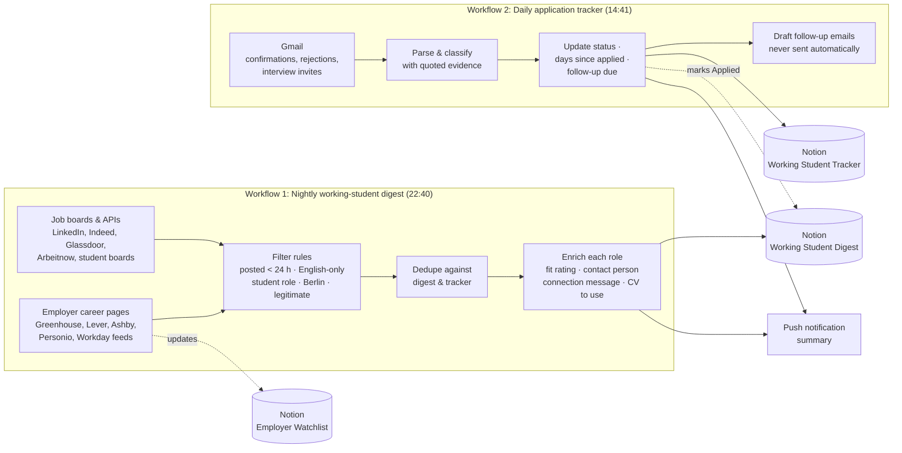

# Working Student Job Search Automation

Two scheduled AI-agent workflows that run my working-student job search end to end: one **finds** new working-student and internship roles in Berlin every night, the other **tracks** every application every afternoon. Everything lands in one Notion workspace, so each morning I open one place and know exactly what to apply for and what to follow up on, which keeps my search manageable alongside my Master's studies.

Designed and built by **Jennifer Omeke** (Berlin) using Claude scheduled tasks connected to Notion, Gmail, Google Drive, Google Calendar and Indeed. Running daily since October 2026.

---

## The problem

Finding a working-student role in Berlin as an English-speaking student meant hours of manual work every day:

- Checking 10+ job boards and company career pages, where most student roles require German
- Losing time on reposted or weeks-old ads that already have hundreds of applicants
- Searching LinkedIn for the right person to contact at each company
- Keeping a spreadsheet of applications up to date by hand, and forgetting to follow up

## The solution

### Workflow 1: Nightly working-student digest
Runs every night at 22:40 so I can apply the same night or first thing in the morning, while a posting is still fresh.

1. **Collects** working-student, internship and student-assistant roles from job boards, job-board APIs, student boards, LinkedIn job-alert emails and the public job feeds of 40+ English-speaking employers on a watchlist (oldest-checked first).
2. **Filters** with strict rules: first posted within the last 24 hours (reposts excluded), English-only, Berlin or Brandenburg, professional office roles, and no scams or mini-jobs.
3. **Deduplicates** against everything already in the digest and tracker.
4. **Enriches** each role with a fit rating, a short "why you fit" note, hours per week and pay, the exact posting time, a verified contact on LinkedIn (hiring manager first, then recruiter), a ready-to-send connection message under 200 characters, and which tailored CV to use.
5. **Writes** the top 15–20 roles into the Notion digest.
6. **Grows the watchlist** by adding 5–10 new English-working employers each night with verified careers URLs.
7. **Sends** a push summary with the top 3 roles.

Full spec: [`01-nightly-working-student-digest.md`](01-nightly-working-student-digest.md)

### Workflow 2: Daily application tracker
Runs every afternoon so the tracker is current by 15:00.

1. **Reads Gmail** (English and German) for application confirmations, ATS emails (Personio, Workday, Greenhouse and others) and sent applications.
2. **Logs** each new application in the tracker, never creating duplicates, and links it back to the digest row it came from.
3. **Updates status only with evidence**, quoting the line from the email: In Review, Assessment, Interview, Offer, Rejected.
4. **Calculates follow-ups**: flags a follow-up at 10–14 days without a reply and marks "No Response" after 21 days.
5. **Drafts** follow-up emails as Gmail drafts only. It never sends anything.
6. **Flags** likely recruitment scams.
7. **Sends** a push summary with new applications, status changes and the most urgent follow-up.

Full spec: [`02-daily-application-tracker.md`](02-daily-application-tracker.md)

---

## Design decisions

| Decision | Why |
|---|---|
| **24-hour freshness rule, verified per posting** | Early applicants get noticed; reposted ads are mostly noise. If a posting time can't be verified, the role is skipped. |
| **Never fabricate** links, names, times or contacts | The output is only useful if every row can be trusted without re-checking. |
| **Status changes need quoted evidence** | Makes the tracker auditable: every status points to the email that caused it. |
| **Human stays in control** | The workflows never apply, never send emails or LinkedIn messages and never modify Gmail. They prepare; I decide. |
| **Fewer rows over padded rows** | If only 6 roles meet the rules, it adds 6 and says so. |

## Tools & stack

- **Orchestration:** Claude scheduled tasks (AI agent with tool access)
- **Data store:** Notion databases (3 linked databases)
- **Inputs:** Gmail, Indeed, job-board APIs (Arbeitnow, pegel.berlin), ATS public job feeds (Greenhouse, Lever, Ashby, Personio, SmartRecruiters, Recruitee, Workday), web search
- **Outputs:** Notion rows, Gmail drafts, push notifications
- **Also connected:** Google Drive, Google Calendar

## Notion structure

| Database | Purpose |
|---|---|
| Working Student Digest | New working-student and internship roles each night |
| Working Student Tracker | Every application and its status |
| Employer Watchlist | English-working employers whose career pages are checked nightly |

Columns for each database: [`databases.md`](databases.md)

## Status

Running daily since **October 2026**: a new working-student digest every night and an updated application tracker every afternoon.

## What I'd improve next

- A weekly report on response rates by area, source and CV version, to learn which applications work
- Automatic sync of interview invites into Google Calendar
- Scoring the fit rating against the job description more systematically

---

*Personal details, database IDs and the candidate profile used by the workflows have been removed from this public version.*
